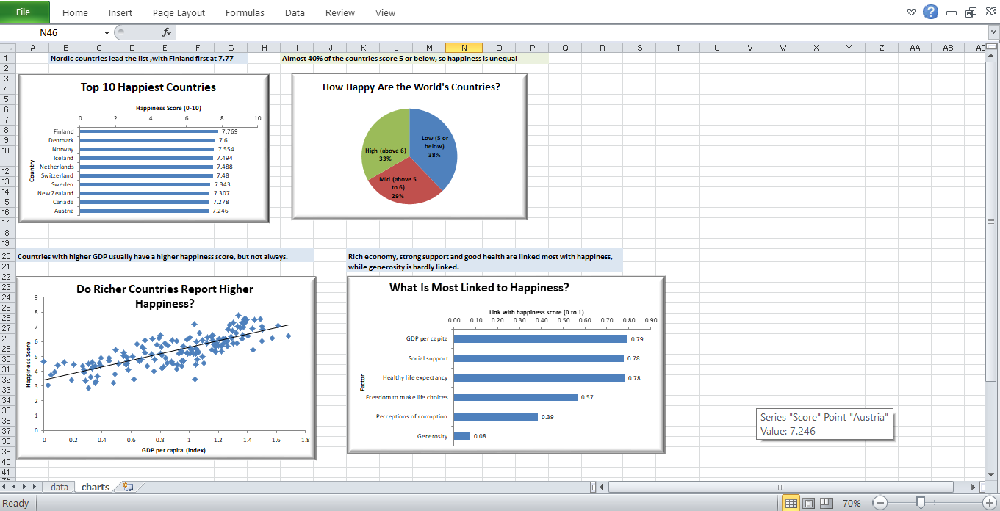

# First Chart Story: Turning Numbers into a Narrative

## Overview
Four labelled charts built in Excel from the 2019 World Happiness Report
(156 countries). Each chart answers one question and has a one-line takeaway.
A short paragraph ties them together.

## Central Question
Which countries are happiest, and what is linked to happiness?

## Charts
1. Bar chart: Top 10 happiest countries
   - Takeaway: Nordic countries lead the list, with Finland first at 7.77.
2. Pie chart (3 slices): How many countries score Low, Mid and High
   - Takeaway: Almost 40% of the countries score 5 or below, so happiness is unequal.
3. Scatter chart: GDP per capita vs happiness score, with a trendline
   - Takeaway: Countries with higher GDP usually have a higher happiness score, but not always.
4. Bar chart: How strongly each factor is linked to happiness (CORREL)
   - Takeaway: Rich economy, strong support and good health are linked most with happiness,while  generosity is hardly linked.

## Why these chart types
- Bar chart: comparing categories (countries, factors)
- Pie chart: parts of a whole, kept to only 3 slices
- Scatter chart: the relationship between two numbers
- Every chart has a title, labelled axes and a takeaway; gridlines and
  unneeded legends were removed

## Tools Used
Microsoft Excel (charts, COUNTIF/COUNTIFS, CORREL)

## Dataset
World Happiness Report 2019 (Kaggle, UN SDSN)

## Screenshot

